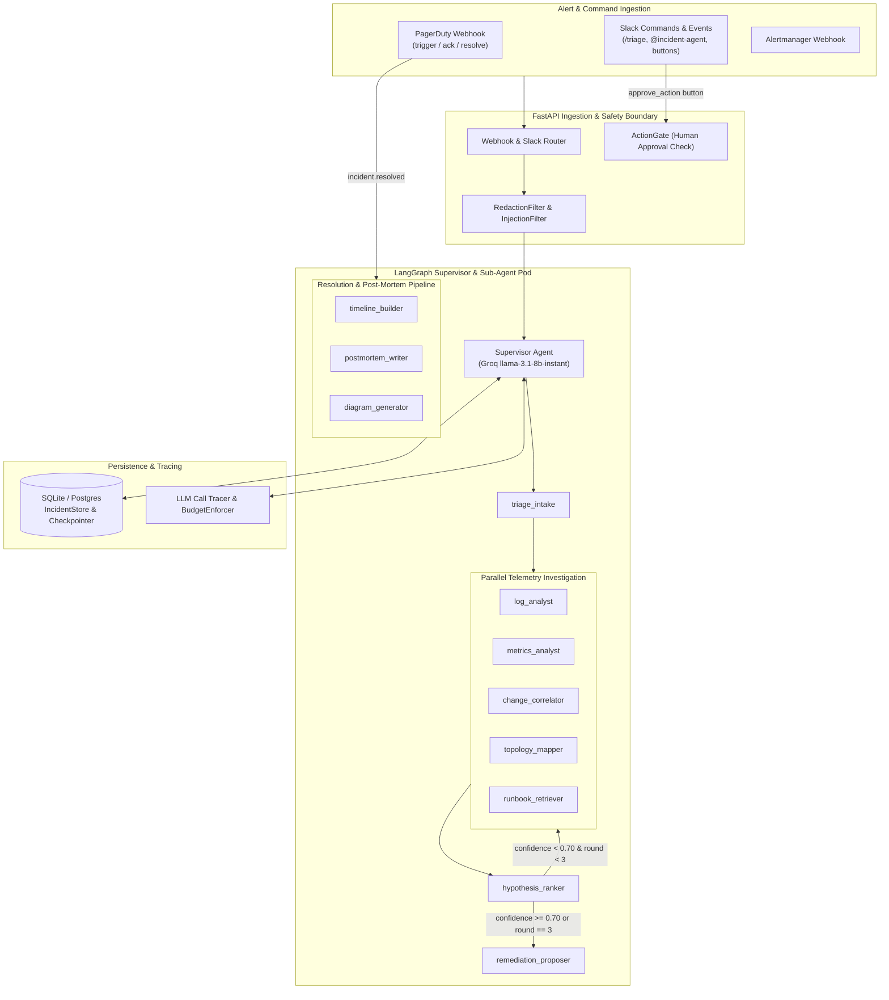

# Incident Response & Root Cause Post-Mortem Agent — Architecture Design

## 1. Architectural Overview

The Incident Response & Root Cause Post-Mortem Agent is designed as a **stateful, multi-agent supervisor-and-sub-agents system** built on LangChain, LangGraph, Pydantic v2, and FastAPI.

When an alert arrives from PagerDuty, Slack, or Prometheus Alertmanager, the system initializes a persistent incident state, posts an immediate Slack acknowledgment, and invokes a **Supervisor Agent**. Rather than stuffing raw logs, metrics, deployments, and runbooks into a single monolithic prompt, the supervisor orchestrates 11 specialized **Sub-Agent Tools**, executing independent telemetry gathering in parallel, enforcing strict token and step budgets, and synthesizing cited, evidence-backed root-cause hypotheses and read-only remediation proposals.

---

## 2. Model Tiers & Provider Routing (`config/models.yaml`)

All model identifiers, context window limits, pricing rates, timeouts, and fallback chains are externalized in `config/models.yaml`. Code components request models strictly by semantic role (`supervisor`, `core`, `long_context`) via the `get_chat_model(role, estimated_tokens)` factory in `src/incident_agent/models/factory.py`.

### Verified Model Specifications (Groq & Google Gemini API)

| Tier Role | Primary Provider & Model ID | Primary Context Limit | Secondary (Fallback) Provider & Model ID | Fallback Context Limit | Responsibilities |
|---|---|---|---|---|---|
| **`supervisor`** | **Groq** `llama-3.1-8b-instant` | `131,072` tokens (max output `8,192`) | **Gemini** `gemini-3.5-flash-lite` | `1,048,576` tokens | Parse alerts (`triage_intake`), plan investigation rounds, route sub-agents, verify confidence thresholds, enforce step/token budgets. |
| **`core`** | **Groq** `llama-3.3-70b-versatile` | `131,072` tokens (max output `32,768`) | **Gemini** `gemini-3.8-flash` | `1,048,576` tokens | Log error clustering, metric anomaly detection, deployment correlation, topology analysis, runbook synthesis, hypothesis ranking, remediation proposals, timeline construction, and blameless post-mortem writing. |
| **`long_context`** | **Gemini** `gemini-3.8-flash` | `1,048,576` tokens (max output `65,536`) | **Gemini** `gemini-2.5-flash` | `1,048,576` tokens | Invoked **only** when a log bundle or multi-service evidence payload exceeds `long_context_token_threshold` (default `24,000` tokens). |

### Routing & Fallback Mechanics
1. **Token-Count Routing (`long_context`):** Before invoking `log_analyst`, the sub-agent estimates the token count of the sanitized log bundle (`len(text) // 4`). If `estimated_tokens > thresholds.long_context_token_threshold`, it requests `get_chat_model("long_context")`; otherwise it uses `get_chat_model("core")`.
2. **Retry with Exponential Backoff & Jitter:** On transient HTTP `429` (Rate Limit) or `5xx` (`500`, `502`, `503`, `504`) errors from the primary provider, the client retries up to `max_retries` (default `2`) with exponential backoff (`base_delay * 2^attempt + uniform(0, jitter)`).
3. **Automatic Provider Failover:** If retries are exhausted on the primary provider (Groq), the wrapper catches the exception, increments the fallback counter, emits a structured `provider_fallback` JSON log event containing `incident_id`, `role`, `from_provider`, `to_provider`, and `error_reason`, and executes the request against the secondary provider (Gemini).

---

## 3. Sub-Agents Exposed as Typed Tools

Every sub-agent lives in `src/incident_agent/subagents/` and is wrapped as a structured LangChain tool with strict Pydantic v2 input/output schemas, an execution timeout, and a per-call token budget.

| Sub-Agent Tool | Tier | Timeout | Max Token Budget | Input Schema (`Pydantic`) | Output Schema (`Pydantic`) | Responsibility |
|---|---|---|---|---|---|---|
| `triage_intake` | `supervisor` | `10s` | `4,000` | `TriageIntakeInput` (raw payload, source type, received timestamp) | `TriageIntakeOutput` (`incident_id`, `service`, `severity`, `environment`, `symptom_summary`, `onset_time`, `window_start`, `window_end`) | Normalize PagerDuty, Slack, or Alertmanager payloads into canonical triage context. |
| `log_analyst` | `core` (or `long_context` if >24k tokens) | `15s` | `16,000` (`64,000` long) | `LogAnalystInput` (`incident_id`, `service`, `window_start`, `window_end`, `severity_filter`) | `LogAnalystOutput` (`clusters: list[LogCluster]`, `first_error_at`, `total_error_count`, `evidence_ids`, `routed_tier`, `source_available`) | Query logs in window, redact PII/secrets, strip prompt injections, cluster error signatures, and pinpoint first occurrence. |
| `metrics_analyst` | `core` | `15s` | `10,000` | `MetricsAnalystInput` (`incident_id`, `service`, `window_start`, `window_end`) | `MetricsAnalystOutput` (`anomalies: list[MetricAnomaly]`, `earliest_onset`, `peak_error_rate`, `peak_latency_p99_ms`, `saturation_metrics`, `evidence_ids`, `source_available`) | Query Prometheus-style RED/USE metrics, detect anomalies against baseline, and identify exact anomaly onset timestamp. |
| `change_correlator` | `core` | `12s` | `8,000` | `ChangeCorrelatorInput` (`incident_id`, `services: list[str]`, `onset_time`, `lookback_minutes`) | `ChangeCorrelatorOutput` (`changes: list[ChangeEvent]`, `most_suspect_change_id`, `correlation_score`, `evidence_ids`, `source_available`) | Retrieve deploys, config updates, and feature flag flips within the lookback window and score temporal/service correlation with onset. |
| `topology_mapper` | `core` | `10s` | `6,000` | `TopologyMapperInput` (`incident_id`, `service`) | `TopologyMapperOutput` (`service`, `owner_team`, `upstream_callers`, `downstream_dependencies`, `critical_path_services`, `evidence_id`, `source_available`) | Map upstream blast radius and downstream dependencies (`db`, `cache`, external APIs, internal services) to check. |
| `runbook_retriever` | `core` | `10s` | `8,000` | `RunbookRetrieverInput` (`incident_id`, `service`, `symptoms: list[str]`) | `RunbookRetrieverOutput` (`runbooks: list[RunbookDocument]`, `past_postmortems: list[PastIncidentSummary]`, `evidence_ids`, `source_available`) | Search operational runbooks and historical post-mortems matching the service and error symptoms. |
| `hypothesis_ranker` | `core` | `15s` | `14,000` | `HypothesisRankerInput` (`incident_id`, `intake`, `log_output`, `metrics_output`, `change_output`, `topology_output`, `runbook_output`, `round_number`) | `HypothesisRankerOutput` (`hypotheses: list[RootCauseHypothesis]`, `top_confidence`, `needs_more_investigation`, `recommended_followup_services`) | Synthesize all collected evidence into ranked root-cause hypotheses with calibrated confidence (`0.0–1.0`) and verified evidence ID citations. |
| `remediation_proposer` | `core` | `12s` | `10,000` | `RemediationProposerInput` (`incident_id`, `hypotheses`, `changes`, `runbooks`) | `RemediationProposerOutput` (`proposals: list[RemediationProposal]`) | Propose safe, reversible mitigation actions tagged with `risk_level`, `rollback_path`, and `proposal_only=True`. |
| `timeline_builder` | `core` | `12s` | `10,000` | `TimelineBuilderInput` (`incident_id`, `state_snapshot`) | `TimelineBuilderOutput` (`events: list[TimelineEvent]`, `ttd_seconds`, `tta_seconds`, `ttm_seconds`, `ttr_seconds`) | Assemble a strictly ordered chronological incident timeline from changes, telemetry onset, alerts, approvals, and resolution. |
| `postmortem_writer` | `core` | `20s` | `16,000` | `PostMortemWriterInput` (`incident_id`, `intake`, `timeline`, `hypotheses`, `proposals`, `approvals`) | `PostMortemReport` (`title`, `markdown_body`, `root_cause_summary`, `action_items: list[ActionItem]`, `blameless_verified: bool`) | Generate a comprehensive, blameless post-mortem report in Markdown with action items and zero personal blame. |
| `diagram_generator` | `core` | `10s` | `6,000` | `DiagramGeneratorInput` (`incident_id`, `intake`, `topology`, `timeline`, `top_hypothesis`) | `DiagramGeneratorOutput` (`incident_sequence_mermaid: str`, `blast_radius_mermaid: str`) | Generate incident-specific Mermaid sequence and blast-radius diagrams for inclusion in the post-mortem. |

---

## 4. End-to-End Control Flow

### Phase A: Active Incident Triage Flow
1. **Alert Ingestion & Acknowledgment:**
   - Webhook (`POST /webhooks/pagerduty`, `POST /webhooks/alertmanager`) or Slack command (`POST /slack/commands`, `POST /slack/events`) arrives.
   - A unique `incident_id` (e.g., `INC-20261024-001`) is created and persisted in `IncidentStore` with status `INVESTIGATING`.
   - `SlackClient` posts an immediate acknowledgment message to the incident channel/thread (`"🚨 Investigating incident INC-... on service ..."`).
2. **Intake Parsing (`Round 1`):**
   - Supervisor invokes `triage_intake` to normalize the alert payload, extracting target service, severity, symptom tags, and time window (`[onset - 60m, alert_time + 15m]`).
3. **Parallel Telemetry & Context Investigation:**
   - Supervisor executes the 5 read-only discovery sub-agents concurrently (`asyncio.gather` / parallel graph fan-out):
     - `topology_mapper` (identifies downstream dependencies)
     - `log_analyst` (clusters error logs on target service)
     - `metrics_analyst` (detects metric anomalies and onset timestamp)
     - `change_correlator` (checks deploys, config changes, and flag flips within 120m of onset)
     - `runbook_retriever` (fetches matching runbooks and similar past post-mortems)
4. **Hypothesis Synthesis & Ranking:**
   - Supervisor passes all gathered evidence objects (and their registered `evidence_id`s) to `hypothesis_ranker`.
   - `hypothesis_ranker` cross-checks every cited `evidence_id` against the collected evidence pool (preventing hallucinated citations) and outputs ranked `RootCauseHypothesis` items.
5. **Iterative Confidence Loop (Capped at 3 Rounds):**
   - If `top_hypothesis.confidence < thresholds.min_hypothesis_confidence` (default `0.70`) **and** `investigation_round < thresholds.max_investigation_rounds` (default `3`) **and** `BudgetEnforcer` confirms remaining tool-call/token budget:
     - The supervisor expands the search to downstream dependencies identified by `topology_mapper` (e.g., querying metrics/logs on `payment-gateway-client` or `inventory-db`) and re-runs `hypothesis_ranker`.
   - Otherwise, or when `investigation_round == 3`, the loop terminates.
6. **Remediation Proposal & Triage Summary Posting:**
   - Supervisor calls `remediation_proposer` to generate reversible mitigation proposals (`requires_approval=True`, `proposal_only=True`).
   - Reporting engine formats the Slack triage summary (including hypotheses, confidence scores, cited evidence IDs, unavailable data sources if any degraded, and remediation proposals with interactive **Approve** / **Reject** action buttons) and posts it to the Slack thread.
   - Incident status transitions to `TRIAGED_AWAITING_APPROVAL`.

### Phase B: Human Approval Gate Flow
7. **Interactive Approval Execution:**
   - If an on-call engineer clicks **Approve** in Slack (`POST /slack/interactions`) or calls `POST /incidents/{id}/approve`, `ActionGate.record_approval()` stores a signed `ApprovalRecord` (`incident_id`, `proposal_id`, `approver_id`, `approved_at`).
   - Only then can `ActionGate.execute_approved_action(incident_id, proposal_id)` execute the simulated mitigation and append an audit entry to the incident timeline.

### Phase C: Resolution & Post-Mortem Flow
8. **Post-Mortem Synthesis on Resolve:**
   - When a PagerDuty `incident.resolved` event arrives (or `/triage resolve` is called), the supervisor transitions to the resolution pipeline:
     1. Calls `timeline_builder` to assemble all chronological events and compute TTD, TTA, TTM, and TTR.
     2. Calls `diagram_generator` to produce Mermaid sequence and topology impact diagrams.
     3. Calls `postmortem_writer` to draft the blameless post-mortem Markdown document.
   - The final post-mortem draft is persisted to SQLite and posted to the Slack incident channel. Incident status transitions to `RESOLVED_POSTMORTEM_COMPLETE`.

---

## 5. State Management & Persistence

### LangGraph State Graph & Checkpointing
The supervisor workflow is modeled as a deterministic state machine (`SupervisorGraph` in `src/incident_agent/supervisor/graph.py`) operating over a typed `IncidentGraphState` dictionary/model.
- **Checkpointing:** After every node transition (`intake`, `investigate_round`, `rank_hypotheses`, `propose_remediation`, `build_postmortem`), the graph serializes a checkpoint into SQLite (`incident_checkpoints` table).
- **Crash Recovery / Resume:** If the process crashes or is killed mid-investigation, calling `resume_incident(incident_id)` reloads the latest checkpoint from `IncidentStore`, restores collected evidence, round counters, and token budgets, and resumes execution from the exact interrupted node without duplicating completed steps.

### Storage Abstraction (`IncidentStore` Protocol)
`src/incident_agent/persistence/store.py` defines an abstract `IncidentStore` protocol with a concrete `SQLiteIncidentStore` implementation backed by SQLite WAL mode:
- `incidents`: Incident metadata, current status, severity, service, serialized state JSON, created/updated timestamps.
- `incident_checkpoints`: Step-by-step graph checkpoints (`incident_id`, `step_name`, `round_number`, `state_json`, `created_at`).
- `evidence_records`: Every piece of telemetry gathered (`evidence_id`, `incident_id`, `source_type`, `service`, `summary`, `raw_json`).
- `approval_records`: Human approval audit trail (`approval_id`, `incident_id`, `proposal_id`, `approver_id`, `decision`, `reason`, `timestamp`).
- `action_executions`: Audit log of executed remediations (`execution_id`, `incident_id`, `proposal_id`, `approver_id`, `status`, `output`, `timestamp`).
- `llm_traces`: Per-call LLM telemetry (`trace_id`, `incident_id`, `subagent`, `role`, `provider`, `model`, `input_tokens`, `output_tokens`, `latency_ms`, `cost_usd`, `fallback_used`, `timestamp`).

Because all persistence calls go through `IncidentStore`, replacing `SQLiteIncidentStore` with a `PostgresIncidentStore` in production requires zero changes to the supervisor or sub-agent code.

---

## 6. Defense-in-Depth Safety Controls

1. **Budget Enforcer (`src/incident_agent/safety/budgets.py`):**
   - Tracks `tool_calls_count`, `total_tokens_used`, and `investigation_rounds` per `incident_id`.
   - Raises `BudgetExceededError` if a sub-agent call would breach `max_tool_calls_per_incident` (default `25`), `max_tokens_per_incident` (default `100,000`), or `max_investigation_rounds` (default `3`).
   - Supervisor catches `BudgetExceededError`, marks `budget_halted=True` in the triage report, and proceeds directly to reporting with partial evidence.

2. **Data Source Allowlist & Read-Only Credentials (`src/incident_agent/safety/allowlist.py`):**
   - Validates that every adapter query targets an allowlisted data source (`logs`, `metrics`, `deploys`, `runbooks`, `topology`) and uses read-only query semantics.

3. **PII & Secret Redaction (`src/incident_agent/safety/redaction.py`):**
   - Deterministically scrubs emails, Bearer tokens, API keys (`sk-...`, `ghp_...`, `xoxb-...`, `AKIA...`), JWTs, basic auth URLs, private keys, SSNs, and IPv4 addresses before text reaches any LLM prompt, database table, or Slack message.

4. **Prompt-Injection Filter (`src/incident_agent/safety/injection.py`):**
   - Scans all untrusted telemetry (log messages, alert descriptions, runbook bodies) for instruction-hijacking patterns (`ignore previous instructions`, `disregard all prior`, `system:`, `<|im_start|>`, `execute_approved_action`, `approve_action`).
   - Neutralizes matched phrases into `[SANITIZED_PROMPT_INJECTION]` and wraps data blocks inside `<untrusted_telemetry>...</untrusted_telemetry>` tags with explicit system instructions that content inside those tags is passive data only.

5. **Mandatory Human Action Gate (`src/incident_agent/safety/action_gate.py`):**
   - `remediation_proposer` can only construct passive `RemediationProposal` objects (`proposal_only=True`).
   - `ActionGate.execute_approved_action(incident_id, proposal_id)` queries `IncidentStore.get_approval(incident_id, proposal_id)`. If no human approval record exists or its decision is not `"approved"`, it raises `UnapprovedActionError` and logs a security violation event.
