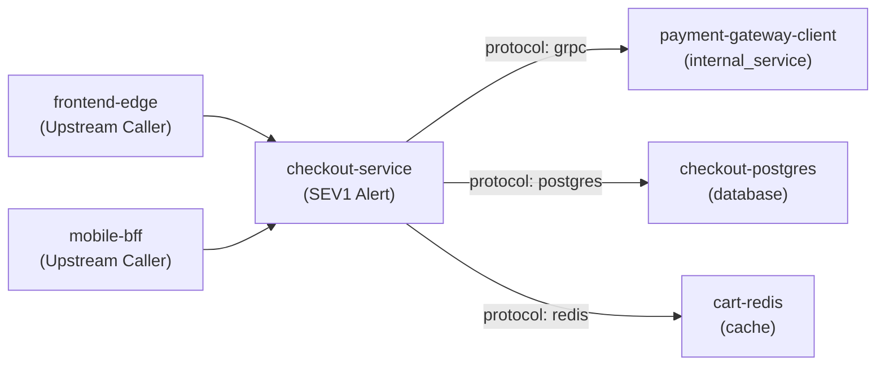
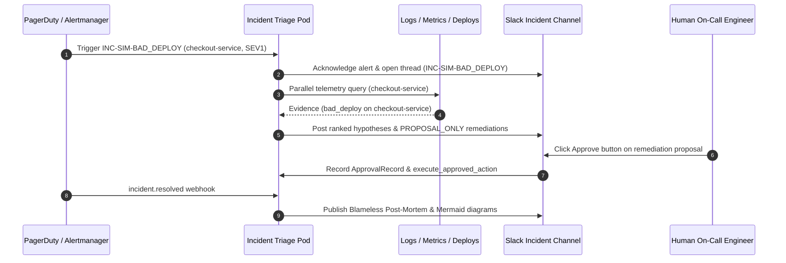

# Blameless Post-Mortem: INC-SIM-BAD_DEPLOY — High 5xx Error Rate on checkout-service (>18.5%)

**Incident ID:** `INC-SIM-BAD_DEPLOY`  
**Service:** `checkout-service`  
**Severity:** `SEV1`  
**Environment:** `production`  
**Culture Policy:** Blameless Systems-Focused Review

---

## 1. Executive Summary

Service `checkout-service` experienced `SEV1` degradation (HTTP 5xx error rate spiked from 0.2% to 18.7% on checkout-service with NullPointerException in PaymentSerializer) in `production`. Time to Detect (TTD): 120s, Time to Acknowledge (TTA): 600s, Time to Mitigate (TTM): 4756s, Time to Resolve (TTR): 4786s.

**Root Cause Summary:** Deployment DEP-2026-8841 (v2.14.0) rolled out 3 minutes prior to the 18.7% HTTP 5xx spike and correlates directly with 1,420 NullPointerException errors in PaymentSerializer.serialize.

## 2. Detection & Response Metrics

- **Time to Detect (TTD):** `120s`
- **Time to Acknowledge (TTA):** `600s`
- **Time to Mitigate (TTM):** `4756s`
- **Time to Resolve (TTR):** `4786s`

## 3. Chronological Incident Timeline

| Timestamp (UTC) | Phase | Source | Evidence ID | Event Description |
|---|---|---|---|---|
| `2026-10-24 14:18:00` | `pre_incident` | `deploys` | `EV-CHG-BD01` | **[KEY]** Change DEP-2026-8841 (deployment: v2.14.0 (commit 9f4b2c1)) applied on checkout-service: Deployed checkout-service v2.14.0 refactoring PaymentSerializer currency handling (3 minutes prior to 5xx onset) |
| `2026-10-24 14:20:00` | `detection` | `alerting` | - | **[KEY]** Alert triggered (INC-SIM-BAD_DEPLOY): High 5xx Error Rate on checkout-service (>18.5%) [SEV1] |
| `2026-10-24 14:30:00` | `triage` | `incident_agent` | - | Incident Response Pod acknowledged INC-SIM-BAD_DEPLOY in Slack and started multi-agent investigation. |
| `2026-10-24 14:33:00` | `onset` | `metrics` | `EV-MET-BD01` | **[KEY]** Metric anomaly onset on checkout-service: HTTP 5xx error rate jumped from 0.2% baseline to 18.7% immediately after v2.14.0 rollout |
| `2026-10-24 14:33:00` | `onset` | `metrics` | `EV-MET-BD02` | **[KEY]** Metric anomaly onset on checkout-service: p99 latency increased 6.36x due to exception stack unwinding on failed checkouts |
| `2026-10-24 14:33:00` | `onset` | `logs` | `EV-LOG-BD01` | **[KEY]** First occurrence of error cluster [HTTP_500_NPE] on checkout-service (1420 total events) |
| `2026-10-24 14:33:15` | `onset` | `logs` | `EV-LOG-BD02` | **[KEY]** First occurrence of error cluster [CHECKOUT_ABORT_500] on checkout-service (1385 total events) |
| `2026-10-24 15:37:16` | `triage` | `incident_agent` | - | **[KEY]** Triage summary, ranked hypotheses, and read-only remediation proposals posted to Slack thread. |
| `2026-10-24 15:37:16` | `mitigation` | `action_gate` | - | **[KEY]** Human responder (U01SRE_ONCALL) recorded 'approved' for remediation proposal PROP-01. |
| `2026-10-24 15:37:16` | `mitigation` | `action_gate` | - | **[KEY]** Executed approved remediation PROP-01 (rollback_deploy) on checkout-service. |
| `2026-10-24 15:37:16` | `resolution` | `pagerduty` | - | **[KEY]** Incident INC-SIM-BAD_DEPLOY marked resolved after telemetry returned to baseline. |

## 4. Root Cause Analysis & Ranked Hypotheses

1. **Regression in recent checkout-service v2.14.0 deployment (NullPointerException in PaymentSerializer)** (`bad_deploy`, Confidence: `0.92`)
   - **Primary Service:** `checkout-service`
   - **Cited Evidence IDs:** `EV-CHG-BD01`, `EV-LOG-BD01`, `EV-MET-BD01`, `EV-RUN-BD01`
   - **Analysis:** Deployment DEP-2026-8841 (v2.14.0) rolled out 3 minutes prior to the 18.7% HTTP 5xx spike and correlates directly with 1,420 NullPointerException errors in PaymentSerializer.serialize.
2. **Transient downstream payment-gateway-client serialization mismatch** (`dependency_timeout`, Confidence: `0.22`)
   - **Primary Service:** `payment-gateway-client`
   - **Cited Evidence IDs:** `EV-MET-BD01`, `EV-MET-BD02`, `EV-TOP-BD01`
   - **Analysis:** Considered downstream contract mismatch, but stack trace fails prior to network call.

## 5. Remediation Proposals Generated

- **`PROP-01` — Rollback checkout-service deployment v2.14.0 to previous revision** (`rollback_deploy`, Risk: `low`)
  - Command: `kubectl rollout undo deployment/checkout-service -n production --to-revision=41`
  - Rollback Path: `kubectl rollout undo deployment/checkout-service -n production --to-revision=42`
  - Status: Proposal Only (Requires Human Approval)

## 6. Systemic Reflection (Blameless)

### Contributing Factors
- Primary technical trigger: Regression in recent checkout-service v2.14.0 deployment (NullPointerException in PaymentSerializer) (Confidence: 92%, Evidence: EV-CHG-BD01, EV-LOG-BD01, EV-MET-BD01, EV-RUN-BD01)
- Automated pre-production canary or load-gate thresholds did not catch the condition prior to full traffic exposure.

### What Went Well
- Automated triage pod ingested the alert, correlated logs, metrics, topology, and changes in parallel, and posted a structured triage summary well within the 2-minute SLA.
- Strict read-only safety gates prevented unapproved production mutations until explicit human on-call approval.
- Secrets and PII in log streams were automatically redacted prior to LLM analysis.

### What Could Be Improved
- Strengthen automated canary validation and pre-deploy/flag guardrails for `checkout-service`.
- Reduce blast radius through tighter circuit-breaker and saturation alerting thresholds.
## 7. Incident Architecture & Sequence Diagrams

### Blast Radius & Dependency Topology

### Incident Lifecycle Sequence

## 8. Preventive Action Items

| ID | Priority | Category | Owner Role | Description |
|---|---|---|---|---|
| `AI-INC-SIM-BAD_DEPLOY-01` | `P0` | `prevention` | Service Owning Engineering Team | Add automated canary regression gate for `checkout-service` covering `bad_deploy` failure mode. |
| `AI-INC-SIM-BAD_DEPLOY-02` | `P1` | `detection` | SRE & Observability Platform Team | Tune early-warning saturation and error-budget burn alerts for `checkout-service` and its critical dependencies. |
| `AI-INC-SIM-BAD_DEPLOY-03` | `P1` | `mitigation` | On-Call Platform Engineering | Codify the verified rollback/mitigation runbook step into automated pre-checks. |
